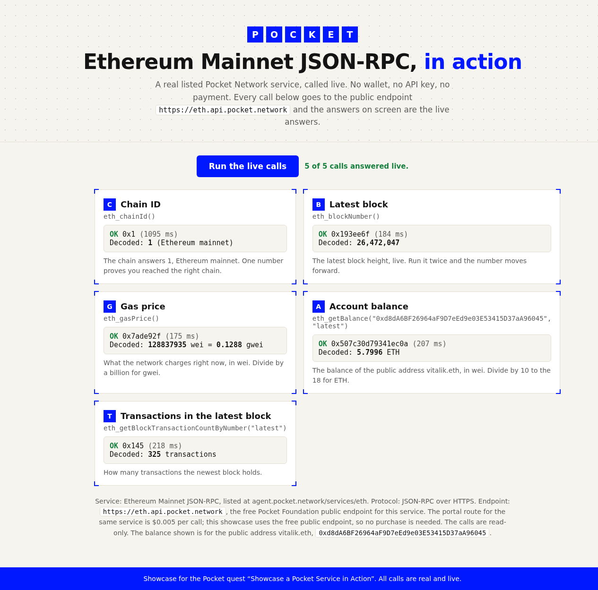

# Pocket Ethereum Showcase

A showcase of the Pocket Ethereum Mainnet JSON-RPC service in action: real calls, real results, no key, no purchase.

**Live demo:** https://pocket-ethereum-showcase.vercel.app/

## Watch it

[Watch the showcase video (73 seconds)](pocket-service-showcase.mp4)

## Read the guide

[SHOWCASE.md](SHOWCASE.md) walks through the service step by step: what it is, the exact requests, the real responses, and what each result means.

## Try it live

[showcase.html](showcase.html) is a live page with a "Run the live calls" button that repeats the whole walkthrough against the same public endpoint.

## Test evidence

[evidence.json](evidence.json) holds the exact requests and responses from the live run: 5 of 5 calls answered, 0 failed.

## No key, no purchase

The calls use the free Pocket Foundation public endpoint `https://eth.api.pocket.network`, with no key and no purchase. Note plainly: the portal route `POST https://agent.pocket.network/v1/eth` costs $0.005 per call via x402. This showcase uses the free public endpoint for the same service, so anyone can repeat it without paying.
